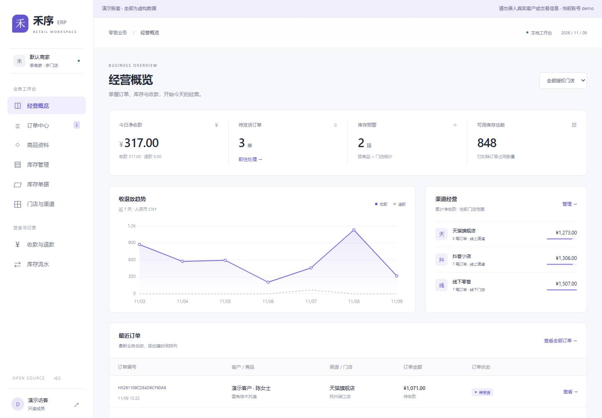
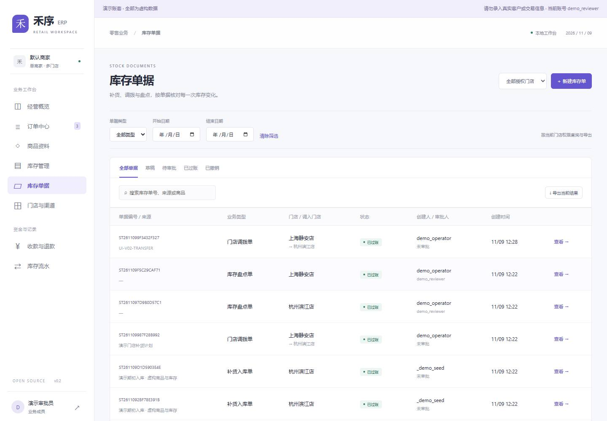
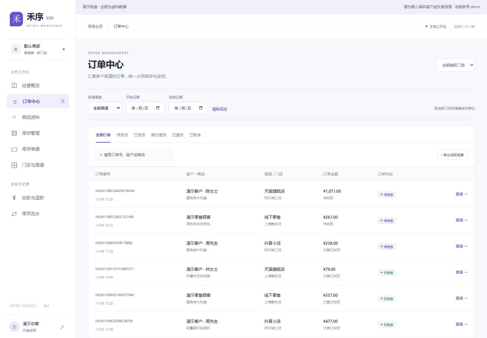
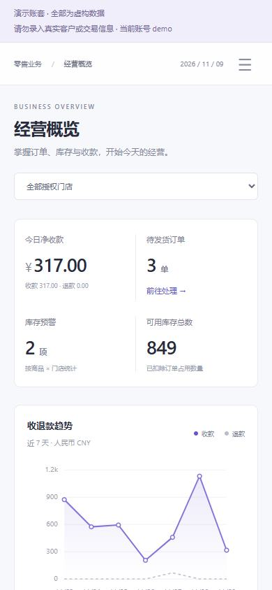

# 禾序 ERP / Hexu ERP

面向电商与零售小团队的开源 ERP 起步项目，工作代号“禾序”。一个商家可管理多个门店、渠道与商品，完成从录单到退货退款的业务闭环。

**当前版本：v0.2.0。** 在 v0.1 业务闭环上增加后端分页筛选、门店权限、库存单据、调拨、盘点双人审批、登录限速和备份恢复校验。平台名称是渠道档案示例；自动拉单和在线支付尚未接入。

## 在线演示与账号

在线地址及账号：[演示说明](docs/DEMO.md)。无需管理员账号即可体验。公开演示使用独立虚构账套，不能访问本地实际业务数据库，管理员入口关闭。

| 账号 | 密码 | 用途 |
| --- | --- | --- |
| `demo` | `HexuDemo2026!` | 只读查看两个演示门店 |
| `demo_operator` | `HexuDemo2026!` | 录单、入库、调拨、提交盘点 |
| `demo_reviewer` | `HexuDemo2026!` | 审批另一名成员提交的盘点单 |
| `demo_store` | `HexuDemo2026!` | 仅上海静安店，用于体验门店隔离 |

这些公开密码仅由 `ERP_DEMO_MODE=1` 的独立演示初始化生成。普通启动仍创建随机管理员密码，不会创建公开账号。请勿录入真实信息。临时在线地址依赖演示主机和连接进程持续运行；本地可执行 `./demo.ps1` 复现。

## 实际界面

### 经营概览



### 库存单据、调拨与盘点



### 订单筛选与分页



<details><summary>查看手机界面</summary>



</details>

## 快速启动

需要 Python 3.12+。在此目录运行：

```powershell
# Windows PowerShell
.\start.ps1
```

```sh
# macOS / Linux
sh start.sh
```

打开 <http://127.0.0.1:8765/>。首次运行会创建演示数据库，并将随机生成的管理员账号密码写入本目录的 `LOCAL_ACCESS.txt`。该文件、数据库及本地密钥已被 Git 忽略。再次启动保留已有业务数据和密码。

如果 PowerShell 的执行策略阻止脚本，可使用下面的逐步启动方式，无需更改系统执行策略：

```powershell
python -m venv .venv
.\.venv\Scripts\python.exe -m pip install -r requirements.lock.txt
.\.venv\Scripts\python.exe manage.py migrate
.\.venv\Scripts\python.exe manage.py init_demo
.\.venv\Scripts\python.exe manage.py runserver 127.0.0.1:8765
```

## 可以实际操作的功能

| 模块 | v0.1 已实现 |
| --- | --- |
| 经营概览 | 今日净收款、待发货、库存预警、七日收退款趋势、渠道累计净收款 |
| 商品 | 创建商品、编辑名称分类售价与预警阈值，SKU 固定，历史订单保留快照 |
| 门店与渠道 | 创建多个门店与线上/线下渠道，门店分别存货 |
| 库存 | 补货入库、订单占用、发货扣库、取消释放、退货回库、低库存筛选 |
| 库存单据 | 多商品入库单、门店调拨单、盘点单；草稿、过账、受限撤销和反向流水 |
| 盘点审批 | 独立审批人、差异调整、库存版本校验，禁止覆盖盘点期间的新业务 |
| 订单 | 多商品录单、渠道订单号去重、全额收款后整单发货、取消 |
| 售后 | 未发货全额退款取消；已发货按商品数量部分/全部退款，可选择不回库 |
| 数据交换 | UTF-8 CSV 批量导入订单，订单/库存/收退款导出，CSV 公式转义 |
| 权限与审计 | 管理员、业务操作员、门店主管、只读成员；门店作用域、CSRF、写入幂等与操作记录 |
| 列表与导出 | 服务端分页，关键词、状态、门店、渠道、日期组合查询；导出复用相同筛选条件 |

收退款为**人工确认已经实际发生后的登记**，系统不会自动扣款或退款。当前使用人民币、两位小数、整数数量、单一销售单位；不处理税额拆分、优惠分摊、运费、分批发货与分次收款。补货为到货记录，不形成采购应付。本版不计算库存成本或利润，不提供总账、法定报表或税务发票。

SQLite 用于本地或单工作线程的隔离演示。正常生产模式强制 PostgreSQL；演示模式明确允许独立 SQLite，不能作为正式经营部署。仓库 CI 覆盖 SQLite 和 PostgreSQL 17，并执行恢复演练。

## 五分钟验收

1. 登录后，在“库存管理”确认上海静安店的 `HX-001` 可用数量。
2. 新建订单，选择上海静安店，添加 `HX-001` 两件。可用数量减少两件，实物库存不变。
3. 打开订单，登记实际收款凭证，再确认发货。实物数量减少两件，占用释放。
4. 在订单中登记一件退货退款，勾选回库。实物数量增加一件，退款金额按原成交价计算。
5. 查看“库存流水”“收款与退款”和“操作记录”，核对以上操作。

导入可使用 [examples/orders.csv](examples/orders.csv)，首次演示导入后再次导入会因重复渠道订单号被拒绝。整批导入失败会回滚全部订单与库存占用。

管理员可在 `/admin/` 创建用户、分配“业务操作员”“门店主管”或“只读成员”分组，并在 StoreAccess 中授权门店。新用户默认没有门店权限。调拨需同时拥有调出和调入门店权限。业务表在后台只读，所有库存及资金变动通过业务服务执行。公开演示环境不提供管理员入口。

## 技术与结构

使用 Django 5.2、原生 JavaScript、HTML/CSS，界面与 JSON API 同源。首版只需一个 Python 环境，不需要前端打包服务；后续可保留业务 API，替换独立前端。业务规则集中在 `core/services.py`。

```text
config/                配置、路由和 WSGI
core/models.py         数据模型与数据库约束
core/services.py       库存、订单、收退款事务
core/views.py          JSON API、权限、幂等、CSV
core/migrations/       已提交数据库迁移
core/management/       演示初始化、角色初始化
core/tests.py          业务与接口测试、PostgreSQL 并发用例
templates/  static/    中文工作台和登录界面
docs/                  产品设计、架构、API、部署、路线图、验收记录
examples/              示例 CSV
```

## 开发与验证

```powershell
.\.venv\Scripts\python.exe manage.py check
.\.venv\Scripts\python.exe manage.py test
.\.venv\Scripts\python.exe manage.py makemigrations --check --dry-run
node --check static/app.js
```

Node 只用于可选的 JavaScript 语法检查；运行产品不需要 Node。测试自动使用临时数据库，不修改演示账套。依赖范围在 `requirements.txt`，已验证的应用依赖在 `requirements.lock.txt`。

设计与交付细节：

- [产品与业务设计](docs/PRODUCT.md)
- [架构与数据设计](docs/ARCHITECTURE.md)
- [API 约定](docs/API.md)
- [部署说明](docs/DEPLOYMENT.md)
- [路线图](docs/ROADMAP.md)
- [v0.2 变更与升级说明](docs/V0.2.md)
- [在线演示与账号](docs/DEMO.md)
- [验证记录](docs/VERIFICATION.md)
- [贡献指南](CONTRIBUTING.md)

## 开源

本项目采用 [Apache-2.0](LICENSE) 许可证。项目名称是工作代号，尚未进行重名与商标检索。完整源码、数据库迁移、启动脚本和设计文档均包含在仓库中。
