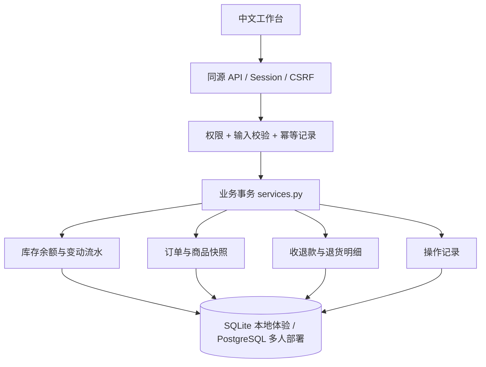
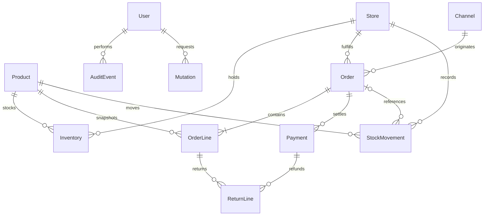

# 架构与数据设计

v0.2 增加 `core/access.py`（门店作用域）、`core/queries.py`（共享查询/导出/分页）、`core/stock.py`（库存单据事务）、`core/login.py`（登录限速）。新增 StoreAccess、StockDocument/Line、LoginAttempt，库存余额增加 version，写入幂等记录保存授权门店快照。完整新增规则见 [v0.2 说明](V0.2.md)；下文的 v0.1 全商家读取与调拨规划已由 v0.2 实现替代。

## 架构决策

首版采用模块化单体。Django 负责登录、权限、数据模型、事务和 API，工作台采用同源 HTML/CSS/原生 JavaScript。无需单独构建前端，贡献者能用一个 Python 环境启动完整业务。未来可在 API 边界接独立 Vue/React 前端，避免同步重写库存规则。

技术建议依据：Django 5.2 是有明确支持窗口的版本；PostgreSQL 的精确数值与行锁适合金额及库存事务。选型是本项目的工程判断，不代表这些文档推荐本 ERP 的具体结构。参考 [Django 版本支持](https://www.djangoproject.com/download/)、[精确数值](https://www.postgresql.org/docs/current/datatype-numeric.html)、[数据库行锁](https://www.postgresql.org/docs/current/explicit-locking.html)。

## 数据关系

| 实体 | 关键字段 | 约束与用途 |
| --- | --- | --- |
| Product | sku, name, category, price, reorder_level | SKU 唯一；售价 Decimal(12,2) 且非负 |
| Store | code, name, location | 编码唯一，存货及履约单位 |
| Channel | code, name, kind | 编码唯一，online/retail；尚无平台令牌 |
| Inventory | product, store, on_hand, reserved | 商品与门店唯一；非负；reserved ≤ on_hand |
| Order | number, channel, external_id, store, customer, status, total, refunded_total, paid_at, shipped_at, actor | 单号唯一；非空渠道单号在渠道内唯一；退款额不超过总额 |
| OrderLine | product, sku, product_name, quantity, returned_quantity, unit_price | 名称和单价快照；退量不超过销量；销量大于零 |
| StockMovement | product, store, order, kind, quantity_delta, reserved_delta, on_hand_after, reserved_after, actor, note | 每次库存操作追加记录，包含变动后余额 |
| Payment | order, kind, amount, reference, actor | 正值金额；receipt/refund 区分方向 |
| ReturnLine | payment, order_line, quantity, restock | 本次退款对应退量及是否回库 |
| AuditEvent | actor, action, object_ref, detail, created_at | 关键业务操作追加记录 |
| Mutation | key, actor, fingerprint, response | UUID 键唯一；请求与结果绑定 |

模型声明在 `core/models.py`，实际建表由提交的 Django 迁移完成，不手工维护另一套 SQL。

## 写入与一致性

每个 HTTP 写入使用数据库事务，包含幂等记录、业务对象、库存余额、变动流水、资金记录和审计。任何步骤失败一并回滚。CSV 所有订单共用外层事务，任何订单不满足约束则整批回滚。

已有订单操作先对订单 `select_for_update()`；涉及多个商品时统一按 product_id 升序锁定库存行。新订单先完成商品校验，再按商品顺序锁定余额、检查可用量、创建订单、追加占用流水。并发下同一商品门店的余额更新串行化，跨商品统一锁序减少死锁机会。异常事务回滚，不在异常后继续写库。

HTTP 写入强制 `Idempotency-Key` UUID。请求指纹包含路径和规范化 JSON；相同用户、相同键、相同内容返回首次成功结果；不同内容或不同用户重复用键返回 409。幂等记录和业务一起提交，失败事务不占用键。渠道订单号提供跨请求业务去重。幂等表目前无自动清理，后续保留策略需先明确平台重试窗口。

PostgreSQL 中行锁必须在事务内使用；SQLite 没有相同的行锁保障，因此本地单人演示通过不代表 PostgreSQL 并发已验证。参见 [Django 事务](https://docs.djangoproject.com/en/5.2/topics/db/transactions/) 和 [select_for_update](https://docs.djangoproject.com/en/5.2/ref/models/querysets/#select-for-update)。并发测试为两个订单争抢最后库存，CI 配置 PostgreSQL 执行；当前本机该用例跳过。

金额后端统一 Decimal，数据库精确小数，JSON 输出十进制字符串。前端数值仅用于显示和预估，总额与退款以服务端计算为准。数量为整数。时间存 UTC，查询和显示按 Asia/Shanghai。

## 访问与记录边界

认证使用 Django Session，同源请求校验 CSRF，生产 Cookie 仅 HTTPS。所有业务模型在管理后台只读；应用公开接口不提供删除流水或直接编辑余额。管理员仍能通过数据库访问修改数据，因此审计记录不是防数据库管理员篡改的合规存证。

当前登录的所有成员可查询整个商家的业务数据及导出数据；只有具有 `core.operate_erp` 的成员能操作订单和库存，`core.manage_catalog` 控制档案和审计页。超级用户负责账号权限管理。数据库外键使用 PROTECT 保留业务引用。

生产在 HTTPS 反向代理后运行；密钥、数据库配置从环境变量读取。应用登录限速、二次验证、门店数据隔离与集中审计尚未实现，应在面向公网运营前补齐。源代码、演示数据库和实际经营账套分开管理。

## 扩展路径

v0.2 先将业务查询改为后端分页，增加采购/调拨/盘点独立单据和完整撤销规则，再增加成本及供应商应付。v0.3 增加渠道连接器、任务队列、外部事件与 outbox。SaaS 多商家需要独立租户模型、查询作用域、唯一约束和隔离测试，不能仅加一个未校验的 tenant_id 参数。
