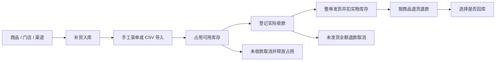
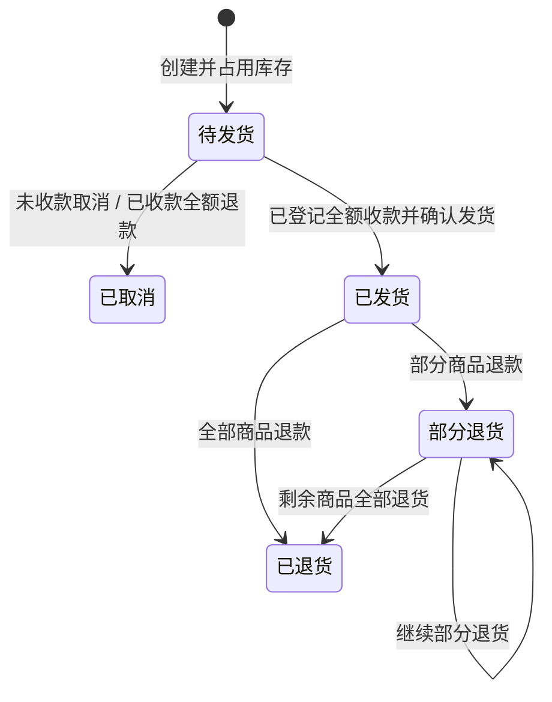

# 产品与业务设计

本文保留订单与资金业务基础。v0.2 已新增门店作用域、库存单据、调拨、盘点审批和服务端分页；这些规则以 [v0.2 说明](V0.2.md) 为准。业务操作员、主管和只读成员只能访问显式授权的门店，管理员管理授权。

## 定位

为同时经营线上渠道和线下门店的小型零售团队提供统一商品、库存与履约工作台。首批验证对象是售卖生活用品、服装配件等普通实物商品的单商家团队。生鲜称重、批次效期、序列号追踪和寄售暂不纳入首版。

核心价值：同一 SKU 在不同门店分别存货，所有渠道共用门店的可用库存；每次实物变动、库存占用、收款与退款都能追溯到业务单和执行人。

## 角色与使用场景

| 角色 | 主要任务 | 权限 |
| --- | --- | --- |
| 管理员 | 建立商品门店渠道、管理成员、监督经营 | 所有业务操作及用户权限管理 |
| 业务操作员 | 录单、补货、收款确认、发货、售后 | 读取商家全部业务数据及业务操作；不能修改商品档案或管理用户 |
| 只读成员 | 查看经营与导出数据 | 商家全部业务数据读取和导出；无写入权限、无审计页权限 |

角色由后端校验，隐藏前端按钮仅辅助操作。当前部署对应一个商家，不提供多个商家共用部署的租户隔离。门店筛选为查询范围，不代表安全权限范围。

## 核心流程

### 商品与门店

商品 SKU 全局唯一，创建后固定。名称、分类、参考售价和预警阈值可编辑。订单行记录创建时的 SKU、名称和成交单价快照；改价不追溯修改历史订单。创建新商品或门店会为现有门店或商品补齐零库存记录。

门店承担履约与存货两个角色，一个订单从一个门店整单出库。多仓拆单、跨店调拨、盘盈盘亏及期初导入需要独立业务单，列入后续版本，不能通过直接编辑库存余额代替。

### 订单与占用

创建订单必须选渠道、门店、客户和 1—100 行商品，同商品须合并为一行。成交单价最多两位小数，数量为 1—1,000,000 的整数。系统按服务端计算订单总额，不信任前端显示值。每一行都必须有足够可用库存，任意一行失败则整单失败。

渠道订单号选填；填写时在相同渠道内唯一。CSV 导入必须填写，按“渠道编码＋渠道订单号”合并商品行，重复已存在订单拒绝整批导入。CSV 每批最多 100 单、500 行，编码 UTF-8，可带 BOM。

### 履约与资金状态

履约状态和收退款独立记录。收款目前只支持整单一次收齐，发货前必须已登记收款。尚未付款的订单可以取消；付款后不能直接取消，要登记实际退款后全额取消。未发货退款只释放库存占用，不增加实物库存。

已发货售后按订单行输入退货数量，并选择商品是否可回库。退款金额为各行原成交单价乘本次退货数量之和。退货数量累计不能超过原销量；不支持仅退差价、退运费或换货。损坏商品可登记退款且不回库。每次退货形成独立资金记录和退货行，原订单与历史记录保留。

收退款凭证是人工登记的交易参考号，不是经过平台验证的支付结果。平台回调、退款申请/到账异步状态、支付手续费与平台账单对账需要独立接入层。

## 库存与指标口径

| 业务 | 实物变化 | 占用变化 |
| --- | --- | --- |
| 补货到货 | +数量 | 0 |
| 创建订单 | 0 | +数量 |
| 整单发货 | −数量 | −数量 |
| 取消未发货订单 | 0 | −数量 |
| 已发货退货且回库 | +本次退货数量 | 0 |
| 退货不回库 | 0 | 0 |

可用库存 = 实物库存 − 占用库存，任何业务结束后必须满足 `0 ≤ 占用 ≤ 实物`。库存预警按“商品×门店”统计，可用量小于或等于商品阈值即预警。

今日净收款 = 上海时区今日登记收款 − 今日登记退款。图表展示近七日按登记时间统计的收款与退款。渠道金额是该查询门店范围内的历史累计净收款；包含已退款订单的原收款和退款记录。所有这些都是资金登记口径，不等同于收入、利润或正式会计报表。

## 页面与交互

视觉主张：浅色经营台面、清楚的中文层级、单一紫色操作强调，密集表格保留足够留白。

信息组织：经营概览给出当前工作量和资金趋势；订单中心承担履约；库存页说明实物和占用；门店与渠道页解释来源与履约关系；资金及流水页承担核对和追溯。

交互主张：导航快速切换；表格搜索即时反馈；业务弹窗聚焦单项操作，并在成功后刷新数据库数据。支持窄屏导航、键盘操作、原生对话框焦点管理和减少动态效果的系统偏好。

列表目前最多展示最近 200 单、200 条资金记录和 200 条库存流水，审计最多 100 条。搜索只针对已加载记录；CSV 导出为全部门店的完整数据。后续版本增加后端分页和查询筛选。

## 后续平台对接设计

将渠道连接器与订单业务解耦。连接器负责平台鉴权、平台状态到内部状态的映射、拉单游标、限流重试和原始报文留存；业务服务继续负责占用、履约与退款约束。建议加入统一 `ExternalEvent` 去重表与事务 outbox，先持久化接收事件，再异步应用和重试。

平台侧已付款但本地缺货的订单必须进入异常队列，保留外部订单和处理状态；不能沿用人工录单的“失败即无单”语义。平台库存同步使用可售库存、预留安全量和版本号，不直接覆盖本地实物数量。以上为 v0.3 规划，当前未实现。
