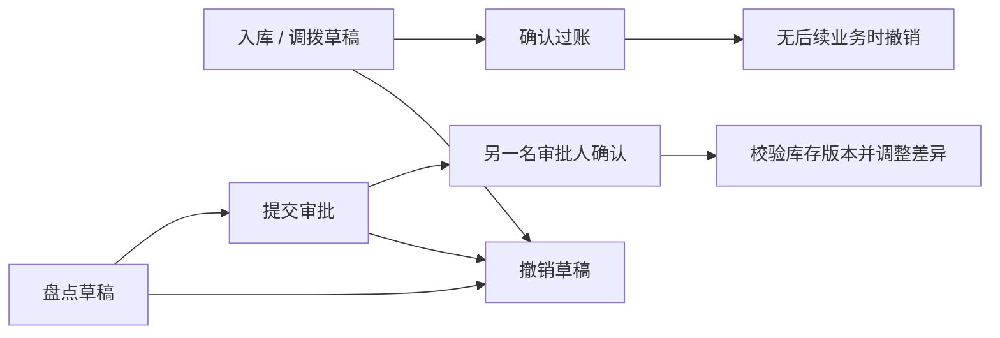

# v0.2 变更与升级

## 交付内容

1. 订单、库存、资金、流水、库存单据与审计使用服务端分页；列表不再受“最近 200 条”限制。支持关键词、状态、门店、渠道、日期及单据类型组合筛选。CSV 使用相同过滤逻辑并导出全部匹配结果，不只导出当前页。
2. StoreAccess 指定成员可访问的门店，后端对查询、指标、导出和写入统一校验。跨门店调拨必须拥有两端权限。收回权限后，相同幂等请求的重放也会被拒绝。
3. 补货入库不再只有裸流水，会生成可追踪的入库单；也支持先保存多商品草稿，再确认过账。历史 v0.1 裸流水保留，显示为历史记录。
4. 调拨过账在一个事务内锁定两端余额并同步增加/扣减实物库存，不能搬走已占用库存。入库和调拨过账后，只有相关商品没有任何后续库存业务时允许撤销；撤销追加反向流水，原记录保留。
5. 盘点草稿保存实物、占用和库存版本快照。提交后须由另一名有 `approve_stock` 权限的成员审批。盘点期间任何占用、发货、取消、入库等导致版本变化，都会拒绝旧盘点；即使数量最后恢复到原值，也不能覆盖新业务。实盘数不能低于现有占用量。
6. 普通和管理员登录都加入账号及来源地址两个维度的限速：10 分钟内失败 5 次后暂停请求。数据库只保存不可逆摘要，不保存明文登录地址或尝试账号。反代源地址不直接信任用户可伪造的转发头。
7. 新增隔离演示和四个公开受限账号；演示初始化账号密码不可用于普通经营账套。公开演示初始化用的超级用户没有可用密码且被停用，管理员入口关闭。
8. `verify_integrity` 核对库存流水快照、余额、待发货占用、订单总额、收退款和退货明细。`scripts/rehearse_restore.py` 在独立数据库恢复快照再检查，原数据库不被覆盖。

## 单据状态



已过账盘点不能直接撤销，需通过新的盘点单修正。当前库存单据草稿不能编辑，输入错误时撤销草稿并重新建立。补货仍是实物到货管理，不构成供应商应付或成本核算。

## v0.1 升级

先停止业务写入并备份，再在相同源码目录执行：

```sh
python manage.py migrate --noinput
python manage.py init_roles
python manage.py verify_integrity
python manage.py collectstatic --noinput
```

迁移保留 v0.1 现有活跃成员原本可访问的全部门店，不会突然锁掉已有成员；新建成员默认无门店权限。升级后管理员应在 StoreAccess 中按实际岗位收紧现有成员的范围。历史数据和流水不会重置。

公开演示请使用 `demo.ps1`；它默认建立 `demo.sqlite3`，与普通 `db.sqlite3` 分开。禁止把真实经营数据库改名后用作公开演示。

## 恢复演练

```sh
python manage.py verify_integrity
python scripts/rehearse_restore.py
```

SQLite 使用数据库在线备份接口复制到独立恢复文件；PostgreSQL 使用一致性事务导出逻辑业务快照，在临时数据库重新迁移、导入并校验。PostgreSQL 运行账号需要创建临时数据库的权限；程序仅删除本次生成并校验过名称的临时数据库。快照包含业务信息和密码散列，保存在被 Git 忽略的 `output/recovery/`，不得上传。

这些演练验证当前应用版本的数据恢复，不代替正式经营的数据库备份保留、异地副本和灾难恢复方案。

## 明确边界

仍为一个商家对应一个部署；多个门店不是多个 SaaS 租户。未接真实电商平台、支付网关、正式会计、成本、税务发票、优惠分摊和多仓拆单。在线临时演示只有一个应用工作线程，不能用于容量承诺。`check --deploy` 的 HSTS preload 提示在临时演示域名下保留，不申请临时域名的浏览器预加载。
